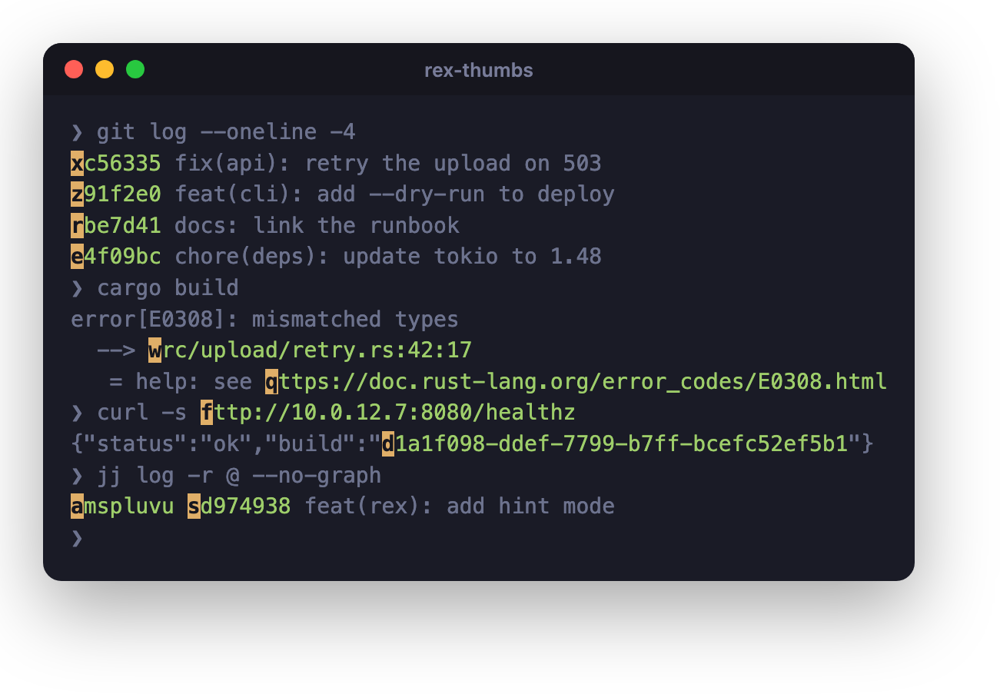

# rex-thumbs

Copy text from a [Rex](https://www.superlogical.com/rex) pane with one or two
keys. rex-thumbs puts a short hint on each URL, path, and hash on the screen.
You type the hint, and the text goes to the clipboard. Hold Shift, and the
text also goes into the pane, as if you pasted it.

rex-thumbs is pure Lua. You install nothing: no Python, no Node, no Go.

rex-thumbs ports [tmux-thumbs](https://github.com/fcsonline/tmux-thumbs) by
Ferran Basora to Rex. The idea, the hint style, and the default alphabet come
from tmux-thumbs. Thank you!



In this picture, <kbd>w</kbd> copies `src/upload/retry.rs:42:17`, and
<kbd>Shift</kbd>+<kbd>W</kbd> also pastes it at the prompt.

## Install

1. Clone this repository next to your Rex configuration file:

   ```sh
   git clone https://github.com/chaosteil/rex-thumbs ~/.config/rex/rex-thumbs
   ```

2. Add this line to `~/.config/rex/init.lua`:

   ```lua
   require("rex-thumbs").setup()
   ```

3. Load the configuration again:

   ```sh
   rex config reload
   ```

If your `init.lua` is in another folder, clone the repository into that
folder. You can also clone it anywhere and load it with
`dofile("/path/to/rex-thumbs/init.lua").setup()`.

To update, run `git -C ~/.config/rex/rex-thumbs pull`, then
`rex config reload`.

## Use

1. Press <kbd>Cmd</kbd>+<kbd>Alt</kbd>+<kbd>Shift</kbd>+<kbd>C</kbd>. You can
   also run **Copy Text With Hints** from the command palette.
2. Type a hint:
   - A lowercase hint copies the text.
   - <kbd>Shift</kbd> and the hint copies the text and pastes it into the
     pane.
3. To stop without a copy, press <kbd>Esc</kbd>, or the same shortcut again.

When there are many matches, a hint has two letters. After the first letter,
the other hints go dim. <kbd>Backspace</kbd> removes the last letter.

If the program in the pane turned on bracketed paste (most shells and
editors do), the paste is a bracketed paste. A shell then does not run the
text on its own.

## Configuration

`setup` takes a table. All fields are optional.

```lua
require("rex-thumbs").setup{
  key      = "cmd+shift+space",          -- false binds no key
  alphabet = "asdfghjkl",                -- the hint letters, in order of use
  patterns = { "JIRA%-%d+", "PR #()%d+()" },
}
```

| Field | Default | Description |
| --- | --- | --- |
| `key` | `"cmd+alt+shift+c"` | The key for the action. See [Keyboard Shortcuts](https://www.superlogical.com/rex/docs/customize/keyboard-shortcuts). |
| `alphabet` | `"asdfqwerzxcvjklmiuopghtybn"` | The letters for the hints. The first letters go to the text nearest the bottom of the screen. |
| `patterns` | `{}` | More patterns, as [Lua patterns](https://www.lua.org/manual/5.1/manual.html#5.4.1). When your pattern and a built-in pattern start at the same column, your pattern wins. Two empty captures `()` select the part to copy: `"PR #()%d+()"` copies only the number. |

The action has the name `thumbs`. To bind more keys, use `rex.bind`:

```lua
require("rex-thumbs").setup{ key = false }
rex.bind("ctrl+b>space", "thumbs")
```

## What gets a hint

- URLs (`https://`, `git@`, `ssh://`, `file:///`), and the URL of a markdown link
- File paths, also with a line and a column, as in `src/main.rs:12:3`
- The paths in the `--- a/` and `+++ b/` lines of a diff
- Git hashes (7 to 40 hex digits) and jj change IDs
- UUIDs and docker digests (`sha256:...`)
- IPv4 addresses, also with a port
- Hex addresses (`0x...`) and hex colors (`#ff00aa`)
- Numbers with 4 digits or more

If the same text is on the screen two times, it gets the same hint.

## How it works

Rex runs `init.lua` on the Rex server. When you press the key, the
`thumbs` action reads the visible lines of the focused pane and finds the
matches. Then it opens the picker pane in a background tab.

The action swaps the picker pane into the place of your pane, as
tmux-thumbs does with `swap-pane`. The picker pane then has the same size as
your pane, so the hints sit on the text.

The picker pane is a small `/bin/sh` loop. It shows the screen that Lua
draws, and sends each key to the `thumbs_key` action with `rex do`. It needs
only `sh`, `stty`, `dd`, `od`, `tr`, and `cat`, which every macOS, Linux,
and FreeBSD system has. rex-thumbs uses no key mode, so Rex shows no panel
of key hints over the pane.

When you pick a hint, or stop, the loop swaps your pane back and closes. It
also does this when a call fails, for example after a configuration reload.

The copy uses `pbcopy` when the Rex server has it. Else the picker pane
sends the text with OSC 52 (the escape sequence for the clipboard), and the
Rex app puts it on its clipboard.

## Limits

- Rex can give the screen and the scrollback of a pane, but not the screen
  alone. rex-thumbs uses the last lines of the scrollback. After `clear`,
  the picker shows the text higher on the screen than your pane does. The
  hints still work.
- You can see a tab with the name "thumbs" in the tab bar while the picker
  is open.
- `thumbs_key` is in the command palette, because Rex has no hidden
  actions. Do not run it yourself.
- The configuration of each Rex server is separate. For panes on a remote
  host, install rex-thumbs on that host too.
- Windows servers do not have `/bin/sh`, so rex-thumbs does not work there.

## Development

Run the tests in the Lua of Rex:

```sh
rex do test/matcher_test.lua
```

Make sure that a configuration that loads rex-thumbs has no errors:

```sh
rex config check
```

## License

MIT. See [LICENSE](LICENSE). rex-thumbs uses ideas and the default alphabet
of [tmux-thumbs](https://github.com/fcsonline/tmux-thumbs), which has the MIT
license, copyright (c) 2019 Ferran Basora.
